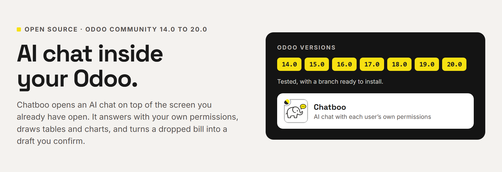
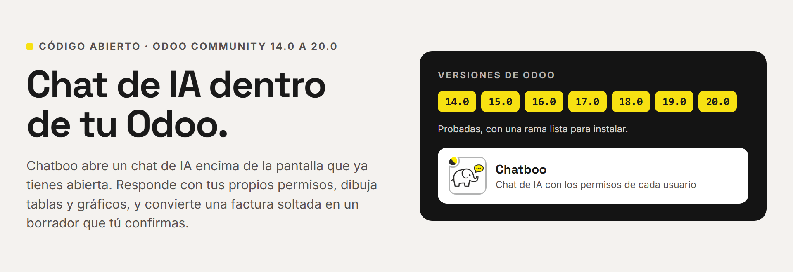

# Chatboo (pns_ai_chatboo)



**[English](#english) · [Español](#español)**

## English

**AI for all your clients, without leaving Odoo.** Chatboo opens an AI chat
on top of the screen your client is already using. It knows what is on that
screen, answers with the user's own permissions, and goes away with one
click. It runs on the AI Engine ([`pns_ai_mcp`](https://github.com/patanegra-soft/pns_ai_mcp)).
Odoo **14.0** and **19.0**.

### The pain

**To use AI, people have to leave Odoo.**
They export spreadsheets into another application, or hand their Odoo
password to an outside service. The answer lands somewhere else, and the
work stops while they copy it back. Chatboo opens on top of the screen they
are already on.

| | |
| :--- | :--- |
| **01 — Waiting while the AI thinks?** | It is a layer you put on and take off. Close it, keep working, and the elephant tells you when the answer is ready. |
| **02 — Does every question cost money?** | Turn what you repeat into a skill. Most of the time it runs without calling the AI: zero cost, same answer every time. |
| **03 — Explaining which record you mean, every time?** | It knows what is on screen. If several records match, click the row and that is it. |

### What you get

**On the screen they already use**
- The elephant in the top bar opens the chat over the current screen. Nobody leaves the record they were on.
- It knows which record or list is on screen.
- When several records could match, it lists them. Click a row and the next question is about that one.
- Conversations are saved and can be reopened. Each user sees only their own.

**Work while it thinks**
- Close the chat and carry on. The answer keeps coming.
- When it is ready, the elephant shows a bell and Odoo shows a notice.
- A long answer can be stopped from the chat.

**Answers they can use**
- Tables whose cells open the record, and charts drawn in the chat.
- Export an answer to PDF, Excel or Word, or copy it.
- Attach a spreadsheet, a Word file, a PDF, an image or plain text, and ask about it.
- Answers can be read aloud.

**Skills that cost nothing**
- Type `/` and pick a skill: a procedure written once, for the client's routines.
- Tables and charts from a skill come from code, not from the AI. Same data, same answer.
- A good answer can be saved as a new skill from the chat itself.
- That knowledge is a service you sell and maintain at each client.

**Safe for your client**
- It reads as the person who asks: their access rights, record rules and companies.
- A change is a plan with a Confirm button. Only users you allow can confirm.

**Put it on, take it off**
- A plain Odoo module: no external server, no build tools.
- Apache 2.0. No fee per user, per database or per year.
- Uninstall it from Apps like any other module.

### Getting started

1. **Install.** From the Odoo Apps Store, download Chatboo: the store brings PNS AI Engine and PNS Base. From git, clone the three on the same series (`19.0` or `14.0`):

   ```bash
   mkdir -p ~/odoo/pns && cd ~/odoo/pns
   for r in pns_base pns_ai_mcp pns_ai_chatboo; do
     git clone -b 19.0 --depth 1 https://github.com/patanegra-soft/$r
   done
   ```

   Each clone is one more entry in `addons_path` (`~/odoo/pns/pns_base,~/odoo/pns/pns_ai_mcp,~/odoo/pns/pns_ai_chatboo`). On Odoo 14, first run `pip install "openpyxl>=3.1.2"`. Restart Odoo, *Apps → Update Apps List* and install **Chatboo**; the other two come with it.
2. **Set up the AI Engine.** Chatboo talks to the AI through `pns_ai_mcp`. Follow its [Getting started](https://github.com/patanegra-soft/pns_ai_mcp#getting-started): AI administrator, your access and one provider.

**Done.** Click the elephant in the top bar.

### For IT staff

#### How it fits

```
pns_ai_chatboo  ──PAAP──▶  pns_ai_mcp  ──▶  AI providers
  (conversation)             (engine)
```

Chatboo owns the conversation: sessions, the chat turn (streamed), the
screen it is opened on and the interface (the app and the overlay from the
top bar). Providers, agents, tools and the AI loop belong to the engine;
Chatboo talks to it through PAAP (Patanegra Application Agent Protocol).
It depends on `web`, `bus`, `mail`, `pns_base` and `pns_ai_mcp`.

A picked row travels with the next message as `{model, id, label}`, so the
engine takes it as the subject instead of searching the name again. The
pick is spent by that message.

#### Repository layout

`main` is one tree for every series. A flat branch (`14.0`, `19.0`) is that tree built for one series, ready for the addons path.

| Path | Contents |
| :--- | :--- |
| `common/` | Version-agnostic code, skills, contexts, data, Apps sheet |
| `stacks/owl1/pns_ai_chatboo/` | Odoo 14 |
| `stacks/owl2/pns_ai_chatboo/` | Odoo 15 and later |

The installer overlays `common/` then the stack; a stack file with the same
path wins. Edit agnostic files only in `common/`. Build a flat module with
`./install_flat.sh 19.0 /path/to/addons`.

Python: on 14, use a current `openpyxl` (old wheels break with recent
NumPy). On 19 there is nothing extra.

#### Odoo versions

| Series | Status |
| :--- | :--- |
| 14.0, 19.0 | Tested. Flat branch published. |
| 15.0 – 18.0 | Not tested, by people or by CI. No branch published. |
| 13.0 and older | Not supported. |

**15.0 to 18.0.** There is no branch to clone. Build the flat modules
yourself from `main`, which has the code for every series (`owl2` for 15.0
and later): `pns_base`, `pns_ai_mcp` and Chatboo.

```bash
git clone https://github.com/patanegra-soft/pns_base.git
git clone https://github.com/patanegra-soft/pns_ai_mcp.git
git clone https://github.com/patanegra-soft/pns_ai_chatboo.git
cd pns_base       && ./install_flat.sh 17.0 /path/to/addons && cd ..
cd pns_ai_mcp     && ./install_flat.sh 17.0 /path/to/addons && cd ..
cd pns_ai_chatboo && ./install_flat.sh 17.0 /path/to/addons
```

The script warns that the series is not tested. Nobody has run Chatboo on
these series, so try it on a test database first and run the Odoo tests
there (see *Tests*). If it works, or does not, tell us
([CONTRIBUTING.md](CONTRIBUTING.md)).

Odoo 13 has no OWL, which the chat is built on. Odoo 8 to 12 run on a
Python older than 3.7, which the engine needs. The suite keeps two stacks
(`owl1` for 14.0, `owl2` for 15.0 and later).

#### Tests

| Where you are | What runs |
| :--- | :--- |
| `main` | `python -m pytest unit_tests`, with no Odoo. Then the Odoo tests, after `./install_flat.sh 19.0 <dir>`. |
| A flat branch (`14.0`, `19.0`) | The Odoo tests in `tests/`. The unit tests live on `main`. |

```bash
odoo-bin -d <db> -i pns_ai_chatboo --test-enable --stop-after-init --test-tags /pns_ai_chatboo
```

### License, marks, training

Apache-2.0 — see [LICENSE](LICENSE) and [NOTICE](NOTICE).
Chatboo™, the elephant-and-speech-bubble device, PATANEGRA Soft™ and PAAP™
are trademarks of PATANEGRA Soft SL; the license does not grant them.
TDM / AI training is allowed (TDMRep `tdm-reservation = 0`).

Security: [SECURITY.md](SECURITY.md). Bugs, ideas and questions: [CONTRIBUTING.md](CONTRIBUTING.md).

---

## Español



**IA para todos tus clientes, sin salir de Odoo.** Chatboo abre un chat de IA
encima de la pantalla que tu cliente ya está usando. Sabe qué hay en esa
pantalla, responde con los permisos del propio usuario y se quita con un
clic. Funciona sobre el Motor de IA ([`pns_ai_mcp`](https://github.com/patanegra-soft/pns_ai_mcp)).
Odoo **14.0** y **19.0**.

### El dolor

**Para usar IA hay que salir de Odoo.**
Se exportan Excels a otra aplicación, o se le da la contraseña de Odoo a un
servicio de fuera. La respuesta llega a otro sitio y el trabajo se para
mientras se copia de vuelta. Chatboo se abre encima de la pantalla en la que
ya estás.

| | |
| :--- | :--- |
| **01 — ¿Esperar mirando cómo piensa la IA?** | Es una capa de quita y pon. La cierras, sigues trabajando y el elefante te avisa cuando la respuesta está lista. |
| **02 — ¿Cada pregunta cuesta dinero?** | Lo que repites lo conviertes en un skill. Casi siempre se ejecuta sin llamar a la IA: coste cero y la misma respuesta cada vez. |
| **03 — ¿Explicarle cada vez de qué registro hablas?** | Sabe qué hay en pantalla. Si varios encajan, pinchas la fila y listo. |

### Qué te llevas

**En la pantalla que ya usan**
- El elefante de la barra superior abre el chat encima de la pantalla actual. Nadie sale del registro en el que estaba.
- Sabe qué registro o qué lista hay en pantalla.
- Si varios registros encajan, los enseña. Pinchas una fila y la siguiente pregunta va sobre esa.
- Las conversaciones se guardan y se pueden reabrir. Cada usuario ve solo las suyas.

**Trabaja mientras piensa**
- Cierras el chat y sigues. La respuesta sigue llegando.
- Cuando está lista, el elefante enseña una campanita y Odoo muestra un aviso.
- Una respuesta larga se puede parar desde el chat.

**Respuestas que sirven**
- Tablas cuyas celdas abren el registro, y gráficos dibujados en el chat.
- Exportar una respuesta a PDF, Excel o Word, o copiarla.
- Adjuntar un Excel, un Word, un PDF, una imagen o un texto, y preguntar sobre él.
- Las respuestas se pueden leer en voz alta.

**Skills que no cuestan nada**
- Escribes `/` y eliges un skill: un procedimiento escrito una vez, para las rutinas del cliente.
- Las tablas y gráficos de un skill salen del código, no de la IA. Mismos datos, misma respuesta.
- Una buena respuesta se puede guardar como skill nuevo desde el propio chat.
- Ese conocimiento es un servicio que vendes y mantienes en cada cliente.

**Seguro para tu cliente**
- Lee como la persona que pregunta: sus permisos, sus reglas de registro y sus compañías.
- Un cambio es un plan con un botón Confirmar. Solo confirman los usuarios que tú permitas.

**Se pone y se quita**
- Un módulo de Odoo normal: sin servidor externo, sin herramientas de compilación.
- Apache 2.0. Sin cuota por usuario, por base de datos ni por año.
- Se desinstala desde Aplicaciones como cualquier otro.

### Puesta en marcha

1. **Instala.** Desde la tienda de Odoo, descarga Chatboo: la tienda trae PNS AI Engine y PNS Base. Desde git, clona los tres en la misma serie (`19.0` o `14.0`):

   ```bash
   mkdir -p ~/odoo/pns && cd ~/odoo/pns
   for r in pns_base pns_ai_mcp pns_ai_chatboo; do
     git clone -b 19.0 --depth 1 https://github.com/patanegra-soft/$r
   done
   ```

   Cada clon es una entrada más del `addons_path` (`~/odoo/pns/pns_base,~/odoo/pns/pns_ai_mcp,~/odoo/pns/pns_ai_chatboo`). En Odoo 14, antes, `pip install "openpyxl>=3.1.2"`. Reinicia Odoo, *Aplicaciones → Actualizar lista de aplicaciones* e instala **Chatboo**; los otros dos entran con él.
2. **Configura el Motor de IA.** Chatboo habla con la IA a través de `pns_ai_mcp`. Sigue su [puesta en marcha](https://github.com/patanegra-soft/pns_ai_mcp#puesta-en-marcha): administrador de IA, tu acceso y un proveedor.

**Listo.** Pulsa el elefante de la barra superior.

### Para el equipo de IT

#### Cómo encaja

```
pns_ai_chatboo  ──PAAP──▶  pns_ai_mcp  ──▶  proveedores de IA
  (conversación)             (motor)
```

Chatboo lleva la conversación: las sesiones, el turno del chat (en
streaming), la pantalla desde la que se abre y la interfaz (la aplicación y
la capa que sale de la barra superior). Los proveedores, los agentes, las
herramientas y el bucle de la IA son del motor; Chatboo le habla por PAAP
(Patanegra Application Agent Protocol). Depende de `web`, `bus`, `mail`,
`pns_base` y `pns_ai_mcp`.

Una fila pinchada viaja con el siguiente mensaje como `{model, id, label}`,
así el motor la toma como el asunto en vez de volver a buscar el nombre. Ese
mensaje la gasta.

#### Estructura del repositorio

`main` es un solo árbol para todas las versiones. Una rama plana (`14.0`, `19.0`) es ese árbol construido para una versión, listo para el addons path.

| Ruta | Contenido |
| :--- | :--- |
| `common/` | Código común a todas las versiones, skills, contextos, datos, ficha de Apps |
| `stacks/owl1/pns_ai_chatboo/` | Odoo 14 |
| `stacks/owl2/pns_ai_chatboo/` | Odoo 15 y siguientes |

El instalador copia `common/` y encima la pila; si un fichero está en los dos,
gana el de la pila. Lo común se edita solo en `common/`. El módulo plano de
una versión se construye con `./install_flat.sh 19.0 /ruta/a/addons`.

Python: en la 14, usa un `openpyxl` reciente (los antiguos fallan con NumPy
moderno). En la 19 no hace falta nada más.

#### Versiones de Odoo

| Versión | Estado |
| :--- | :--- |
| 14.0, 19.0 | Probadas. Rama plana publicada. |
| 15.0 – 18.0 | Sin probar, ni por personas ni por el CI. Sin rama publicada. |
| 13.0 y anteriores | No soportadas. |

**De la 15.0 a la 18.0.** No hay rama que clonar. Construye tú los módulos
planos desde `main`, que tiene el código de todas las versiones (`owl2` para
la 15.0 y siguientes): `pns_base`, `pns_ai_mcp` y Chatboo.

```bash
git clone https://github.com/patanegra-soft/pns_base.git
git clone https://github.com/patanegra-soft/pns_ai_mcp.git
git clone https://github.com/patanegra-soft/pns_ai_chatboo.git
cd pns_base       && ./install_flat.sh 17.0 /ruta/a/addons && cd ..
cd pns_ai_mcp     && ./install_flat.sh 17.0 /ruta/a/addons && cd ..
cd pns_ai_chatboo && ./install_flat.sh 17.0 /ruta/a/addons
```

El script avisa de que esa versión no está probada. Nadie ha usado Chatboo
en estas versiones: pruébalo antes en una base de pruebas y pasa ahí los
tests de Odoo (ver *Tests*). Si funciona, o si no, cuéntanoslo
([CONTRIBUTING.md](CONTRIBUTING.md)).

Odoo 13 no tiene OWL, sobre el que está hecho el chat. De Odoo 8 a 12 usan un
Python anterior al 3.7, que es el que necesita el motor. La suite mantiene dos
pilas (`owl1` para la 14.0 y `owl2` para la 15.0 y siguientes).

#### Tests

| Dónde estás | Qué se ejecuta |
| :--- | :--- |
| `main` | `python -m pytest unit_tests`, sin Odoo. Después los tests de Odoo, tras `./install_flat.sh 19.0 <dir>`. |
| Una rama plana (`14.0`, `19.0`) | Los tests de Odoo en `tests/`. Los unitarios viven en `main`. |

```bash
odoo-bin -d <db> -i pns_ai_chatboo --test-enable --stop-after-init --test-tags /pns_ai_chatboo
```

### Licencia, marcas, entrenamiento

Apache-2.0: ver [LICENSE](LICENSE) y [NOTICE](NOTICE).
Chatboo™, el dibujo del elefante con el bocadillo, PATANEGRA Soft™ y PAAP™
son marcas de PATANEGRA Soft SL; la licencia no las concede. Se permite la
minería de textos y el entrenamiento de IA (TDMRep `tdm-reservation = 0`).

Seguridad: [SECURITY.md](SECURITY.md). Errores, ideas y preguntas: [CONTRIBUTING.md](CONTRIBUTING.md).
